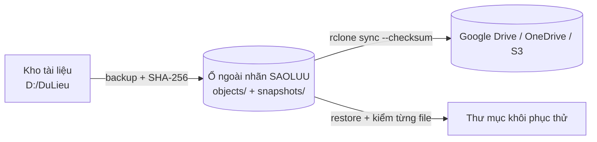

# dual-backup

[](https://github.com/ferbdev-byte/dual-backup/actions/workflows/ci.yml)


Sao lưu một thư mục ra **ổ cứng ngoài** và **cloud** (qua rclone), có chống trùng, manifest SHA-256 và lệnh **khôi phục thử**. Viết theo nguyên tắc: *một bản sao lưu chưa từng khôi phục thử thành công thì chưa được tính là bản sao lưu.*



## Tính năng

- **Content-addressed**: mỗi file lưu theo SHA-256 của nó. File trùng nội dung (bản sao, đổi tên, di chuyển) chỉ lưu một lần; mỗi lần sao lưu sau chỉ ghi phần thay đổi.
- **Nhiều phiên bản**: mỗi lần chạy là một snapshot, khôi phục được đúng trạng thái của bất kỳ ngày nào.
- **Kiểm chứng thật**: `verify` băm lại từng object và so với tên; phát hiện cả file mất lẫn file hỏng (bit rot).
- **Khôi phục an toàn**: chỉ khôi phục vào thư mục rỗng (không bao giờ ghi đè), giữ nguyên ngày sửa, kiểm SHA-256 từng file sau khi chép.
- **Tự tìm ổ ngoài theo nhãn**: cắm ổ có nhãn `SAOLUU` vào cổng nào cũng được, không phụ thuộc ký tự ổ.
- **Dọn bản cũ**: giữ N bản gần nhất và một bản mỗi ngày trong M ngày, tự xoá object không còn dùng.
- **Đẩy cloud thông minh**: object không bao giờ bị sửa, nên `rclone sync` chỉ đẩy phần mới.

## Cài đặt

```powershell
pip install git+https://github.com/ferbdev-byte/dual-backup
winget install Rclone.Rclone   # chỉ cần nếu đẩy lên cloud
```

## Dùng

```powershell
# Sao lưu ra ổ ngoài có nhãn SAOLUU, kiểm chứng ngay, rồi đẩy lên Google Drive
dualbackup --drive-label SAOLUU backup D:\DuLieu --remote gdrive:SaoLuu

# Xem các bản
dualbackup --drive-label SAOLUU list
# 20261121-190000  21/11/2026 19:00     1532 file     842.3 MB
# 20261122-190000  22/11/2026 19:00     1540 file     845.0 MB

# Kiểm chứng toàn bộ (băm lại từng object)
dualbackup --drive-label SAOLUU verify

# So hai bản: file nào thêm, xoá, sửa
dualbackup --drive-label SAOLUU diff 20261121-190000 20261122-190000

# Diễn tập khôi phục: lấy lại thư mục hop-dong của ngày 21/11
dualbackup --drive-label SAOLUU restore D:\DienTap --name 20261121-190000 --only hop-dong
```

Mã thoát: `0` ổn, `2` kiểm chứng lỗi, `3` rclone lỗi. Có thể dùng mã này để gửi cảnh báo trong Task Scheduler.

## Dùng như thư viện

```python
from dualbackup import Store

store = Store("E:/dualbackup")
snap, new_objects = store.backup("D:/DuLieu")
assert store.verify(snap.name).ok
store.restore("D:/DienTap", name=snap.name)
```

## Bố cục kho

```
dualbackup/
├── objects/
│   └── 3f/3fa8c1...   ← nội dung file, tên = SHA-256
└── snapshots/
    └── 20261123-190000.json   ← đường dẫn, cỡ, sha256, mtime của từng file
```

Kho là file thường: dù không còn công cụ này, vẫn đọc được manifest JSON và lấy file bằng tay.

## Phát triển

```powershell
pip install -e ".[dev]"
ruff check .
pytest
```

## Giấy phép

MIT
